# Diagram catalog

Copy-ready patterns for the Pele branch, one per family. Each pattern names when to use the family, when another family carries the meaning better, the size past which it stops being readable, and the pitfalls observed in Pele. Replace labels and data; leave the grammar alone.

**Status of these entries:** each block is authored against the Mermaid grammar documentation, and every block in this file parsed and rendered through `pele.render()` in Obsidian 1.15.0 (installer 1.13.4, desktop) — level B in [`pele.md`](pele.md). Every pitfall marked *observed* was reproduced the same way. None of them is renderer-verified in your target note; only opening it in the target Obsidian produces level D. Run the compatibility gate in [`pele-compatibility.md`](pele-compatibility.md) before using a version-gated or Pele-only family on an app older than 1.15.0.

All examples are synthetic and describe a fictional public library branch.

## Contents

- Conservative core — [flowchart](#flowchart), [sequence](#sequence-diagram), [class](#class-diagram), [state](#state-diagram), [entity relationship](#entity-relationship-diagram), [gantt](#gantt), [journey](#user-journey), [pie](#pie), [mindmap](#mindmap), [timeline](#timeline)
- Version-gated — [sankey](#sankey), [kanban](#kanban), [treemap](#treemap), [architecture](#architecture), [xy chart](#xy-chart)
- Pele-only — [swimlane](#swimlane), [block](#block), [agentflow](#agentflow), [git graph](#git-graph), [event modeling](#event-modeling), [radar](#radar), [quadrant](#quadrant-chart), [venn](#venn), [requirement](#requirement-diagram), [C4 context](#c4-context), [use case](#use-case), [packet](#packet), [railroad](#railroad), [tree view](#tree-view), [ishikawa](#ishikawa), [cynefin](#cynefin), [wardley](#wardley-map)
- [Fallbacks that keep the meaning](#fallbacks-that-keep-the-meaning)

## Conservative core

These families have been part of Mermaid long enough that Pele and any older bundle new enough to render diagrams at all are expected to accept them. Prefer them whenever they can carry the meaning.

### Flowchart

Ordered steps with branches. The default choice, and the fallback for any structural diagram.

**Use** for steps, branches and loops, or cause and dependency explained one arrow at a time. **Avoid** when three or more actors hand work to each other (swimlane) or when messages run in time order (sequence). **Keep under** 15 nodes; a label is a name line plus at most one role line.

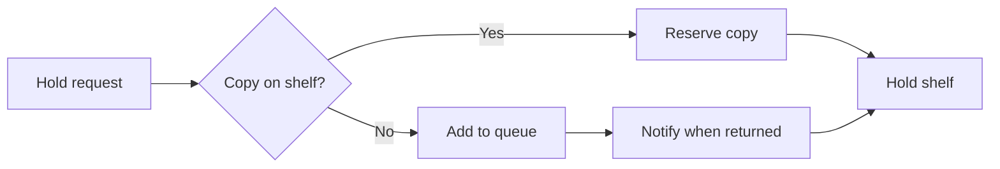

`TD` swaps to top-down. Group related nodes with `subgraph <name> ... end`; remember that lowercase `end` as a node label breaks the parser.

Two-line labels with a bold name, a dotted edge for an interpretive or secondary relation, and a grouped side process:

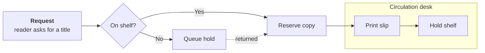

- Below about 640 pixels of width Pele may draw a `flowchart LR` top-to-bottom. The note cannot pin the direction; write the diagram so it reads both ways.
- Two subgraphs with no edge between them stack vertically even under `LR`. To compare them side by side, make two diagrams.
- `<code>`, `<kbd>`, `<sub>` and `<sup>` inside a label draw as plain text in Obsidian 1.15.0 (*observed*). Write a literal angle bracket as `#lt;` and `#gt;`.

### Sequence diagram

Who sends what to whom, in order. Declare participants so the column order is deliberate rather than accidental.

**Use** for requests and replies between participants, including branches and repeats. **Avoid** past six participants or fifteen messages — split at a phase boundary. **Keep under** 5 participants and 12 messages.

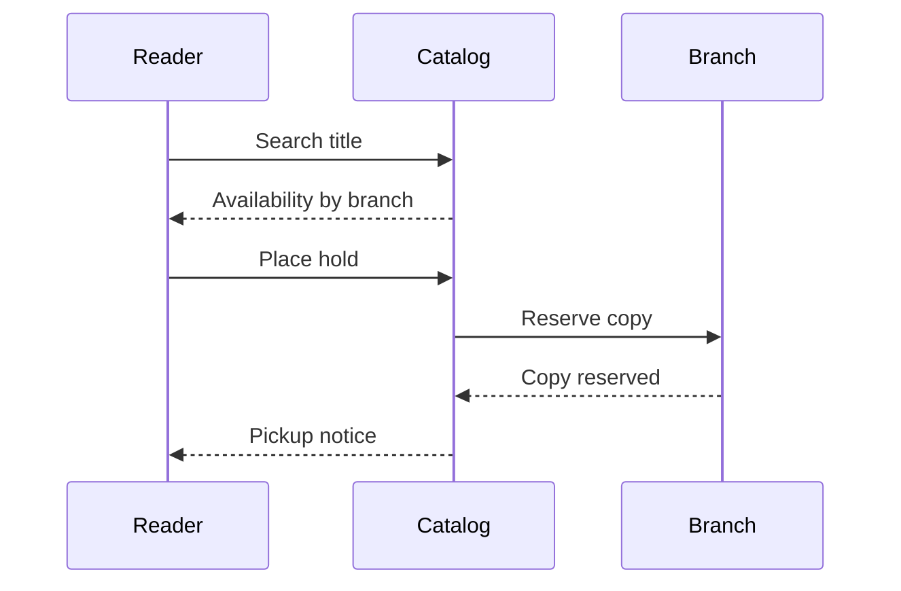

`->>` draws a solid arrow (a call), `-->>` a dotted one (conventionally a reply). Use `Note over A,B: text` for context that is not a message.

Numbered messages, a decision inside one participant as a self-call, and the `alt`, `loop` and `opt` blocks with the condition in the block title:

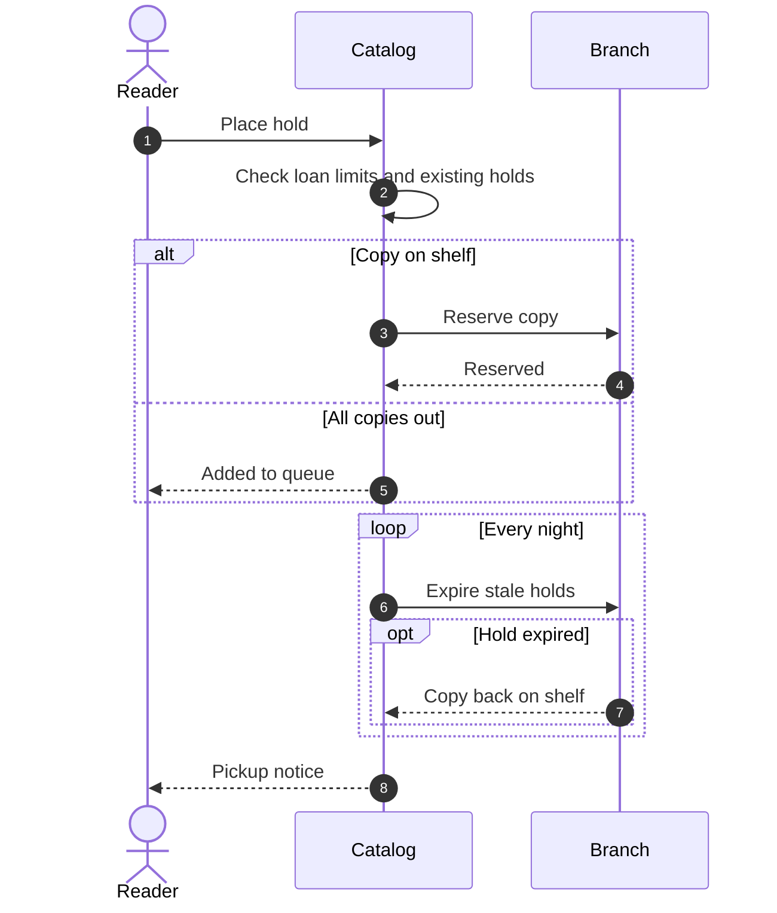

Nest blocks at most two deep; a third level stops being readable. An explanation longer than two lines reads better as `Note over`.

### Class diagram

Types, their members, and cardinality. A domain model, not a runtime path.

**Use** for attributes, methods, composition and dependency. **Avoid** for readers who are not developers — simplify to a flowchart. **Keep under** 6 classes.

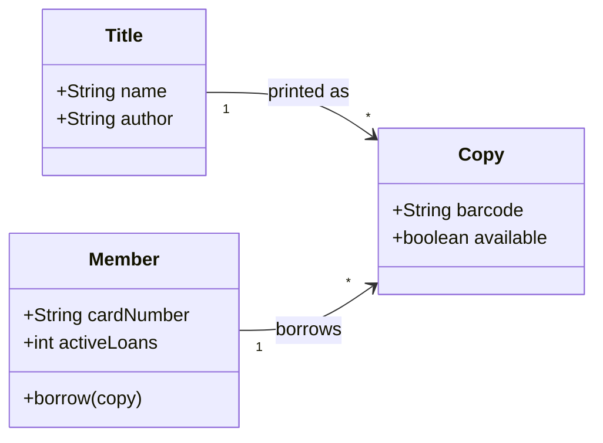

`*--` is composition, `o--` aggregation, `..>` dependency.

### State diagram

The lifecycle of one thing. The `-v2` suffix is part of the keyword.

**Use** for the states one thing passes through and what triggers each change. **Avoid** when the content is a sequence of actions, not states (flowchart). **Keep under** 8 states.

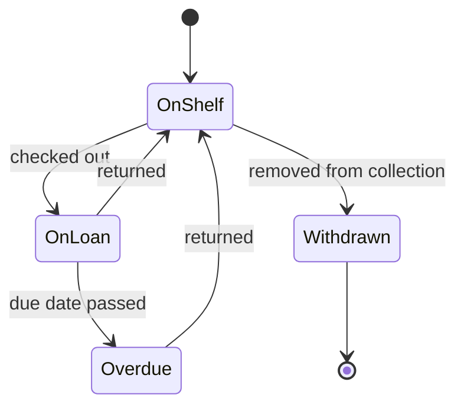

A state with inner stages is a composite `state Name { }`; an edge leaving it applies from every inner stage. `note right of` attaches a rule, and `direction LR` lays the lifecycle out horizontally:

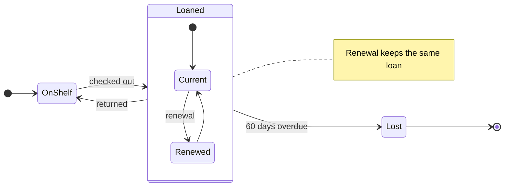

### Entity relationship diagram

Stored entities, their attributes, and how they relate.

**Use** for entities, keys and cardinality. **Avoid** when the attribute lists get long — a table carries them better, and a relations-only diagram beside it gives the overview. **Keep under** 6 entities.

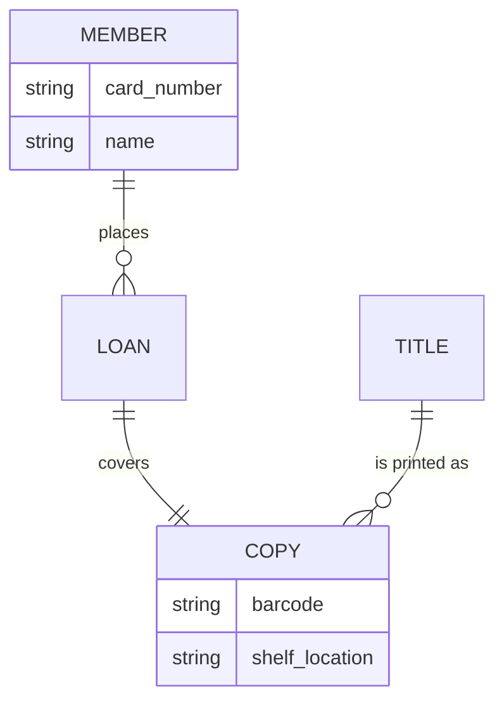

Cardinality is encoded in the connector: `||` exactly one, `o{` zero or more, `|{` one or more. Pele gathers every relation marker leaving one entity at the bottom centre, and keeps the diagram near 770 pixels wide however narrow the note is.

### Gantt

Dated work with real durations. `dateFormat` describes the dates you write, `axisFormat` the axis labels.

**Use** for start, length, overlap, deadlines and milestones. **Avoid** when there is only order and no dates (timeline or flowchart). **Keep under** 10 tasks in 4 sections.

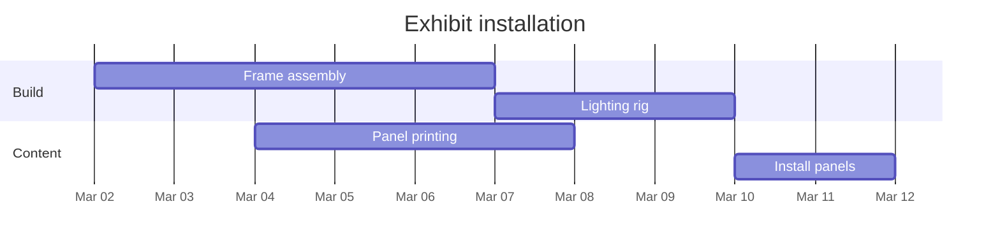

Task states come before the id: `done`, `active`, `crit`, and `milestone` with a `0d` duration:

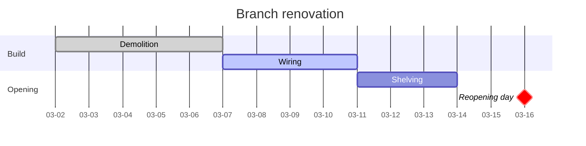

### User journey

A step-by-step experience with a score and the actors involved. The score is 1–5 and precedes the actor list.

**Use** for how good or bad each step of an experience is. **Avoid** when no score was measured and one would have to be invented; if the scores are design intent, say so in the title. **Keep under** 4 sections and 10 steps.

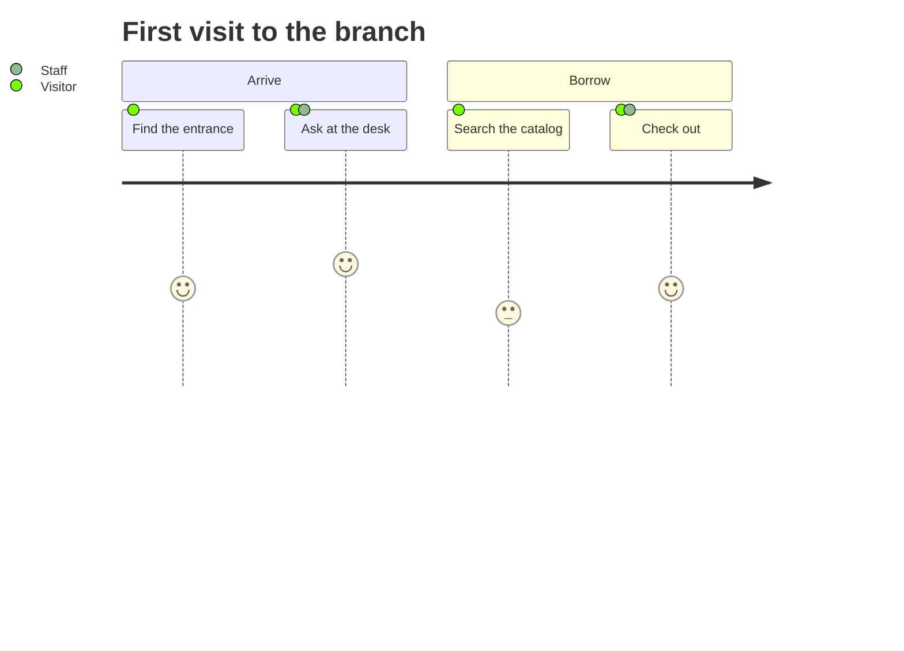

### Pie

Parts of one whole, single level. Quote every label.

**Use** when the share of a whole is the message. **Avoid** past seven slices or when values are close (xy chart). **Keep under** 6 slices; fold the rest into `"Other"`.

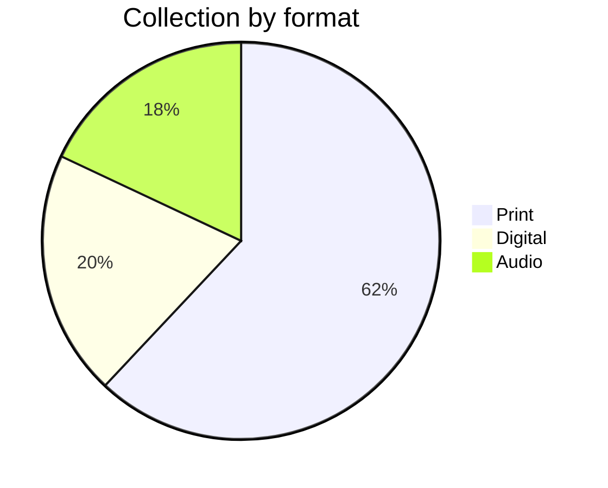

`showData` prints the values beside the shares; name the source of the numbers in the caption. Pele omits the percentage label of a slice under 1%.

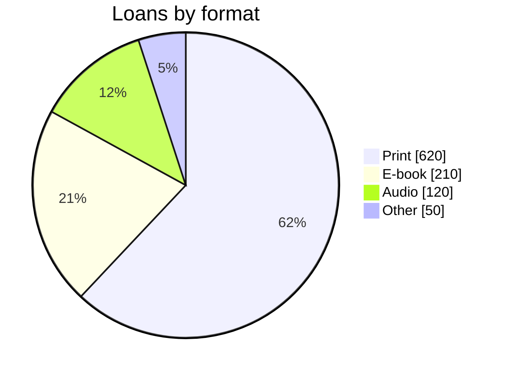

### Mindmap

A branching outline of one topic. Indentation is the entire grammar — keep it consistent and never mix tabs with spaces.

**Use** for the concepts and categories branching from one topic. **Avoid** when relations between branches matter (flowchart). **Keep under** 9 first-level branches and 25 nodes.

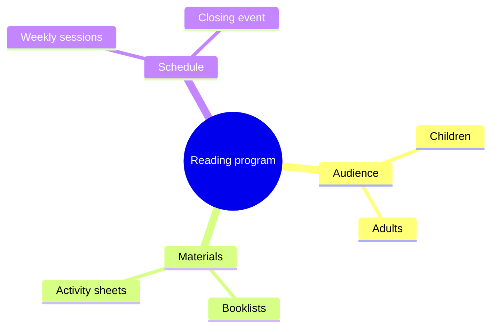

- `classDef` inside a mindmap is parsed as a second root and fails with *There can be only one root* (*observed*).
- Pele draws a first-level node that has no children as bare text without a box. Give it a child or an explicit shape.

### Timeline

Dated milestones in order. A period may carry several events on the same line, separated by colons.

**Use** for dated events grouped by era or phase. **Avoid** when the length of a period matters (gantt). **Keep under** 3 sections and 8 periods.

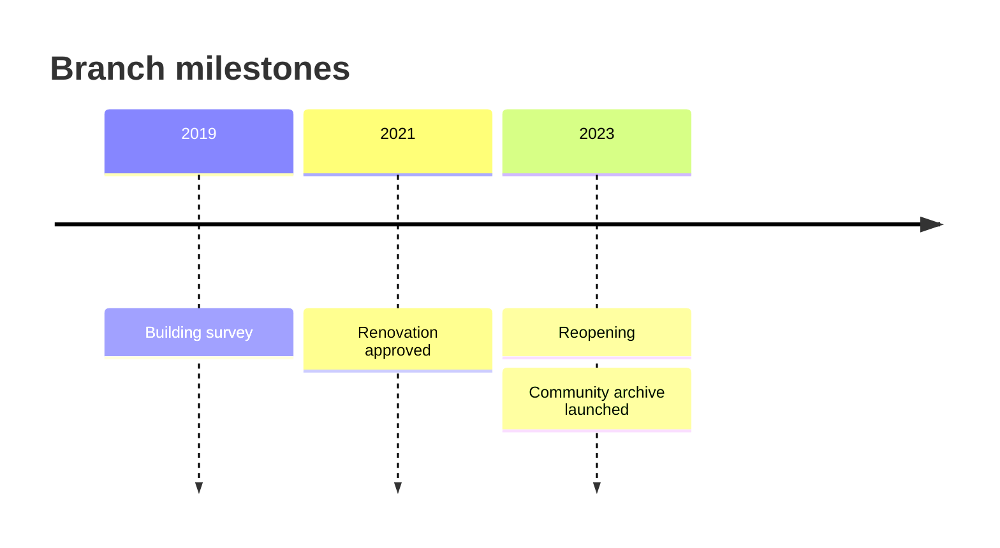

Pele paints section headers and period boxes with the background colour as text colour, so legibility depends on the vault theme's contrast; check it at level D.

## Version-gated

Pele (Obsidian 1.15.0+) renders every family below. Each still needs the compatibility gate first, because a vault is also read on devices whose app predates Pele and ships an older Mermaid bundle; each entry names the fallback to use when that bundle rejects it. The `-beta` spellings are kept because Pele accepts them and older bundles need them.

### Sankey

Quantified flow between stages, written as three-column CSV: source, target, value.

**Use** for how a quantity splits as it moves: funnels, budgets, outcomes. **Avoid** when the stages have no values (flowchart). **Keep under** 12 nodes.

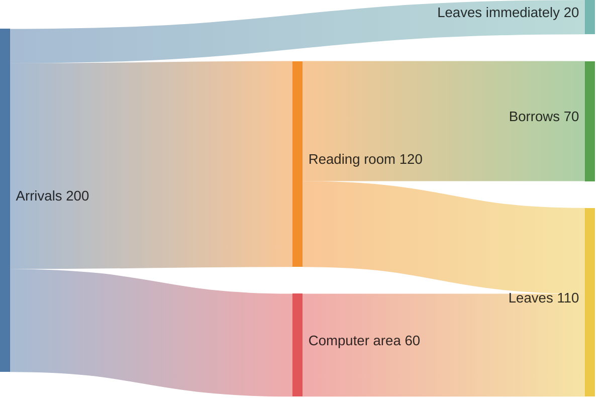

Current Mermaid accepts `sankey` and `sankey-beta`; older bundles accept only `sankey-beta`, so the suffixed form is the compatible one. Wrap any value containing a comma in double quotes.

- Node names must be ASCII in Obsidian 1.15.0: a Hangul name fails with *Parse error on line 2* (*observed*). Put non-English explanation in the caption.
- Do not write totals into node names; Pele appends each node's value itself. A very small flow draws hairline-thin and disappears in dark themes.

**Fallback:** a `flowchart LR` whose edge labels carry the quantities.

### Kanban

Work items grouped by workflow column. Columns are top level, tasks are indented beneath them.

**Use** for items by state: waiting, in progress, done. **Avoid** when dates are the point (gantt). **Keep under** 4 columns and 12 cards.

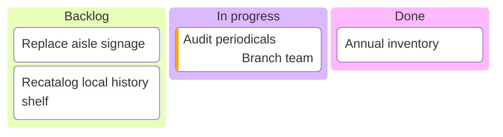

Metadata keys are `assigned`, `ticket`, and `priority`; `priority` accepts only `Very High`, `High`, `Low`, and `Very Low`. Narrower than its natural width (about 640 pixels), Pele folds three columns into two plus one.

**Fallback:** a Markdown table with one column per stage, or headings with task lists. Both keep every item and its stage.

### Treemap

Nested proportions. Quoted names, indentation for hierarchy, `: value` on leaves.

**Use** for the size of hierarchical quantities compared by area. **Avoid** when there is no hierarchy (pie or xy chart). **Keep under** 5 groups and 15 leaves; fold small leaves into `"Other"`.

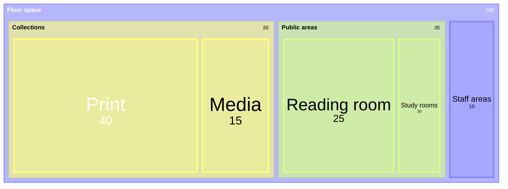

Upstream marks this as a new diagram type whose syntax may still change, so pin the exact spelling you verified. At narrow widths Pele draws a small group as an empty box without its name or children and truncates small tile names character by character.

**Fallback:** `pie` for a single level, plus a table or nested list for the levels `pie` cannot show. Do not ship the `pie` alone if the hierarchy was the point.

### Architecture

Services, the groups that contain them, and directed links between them.

**Use** for services, stores, groups and their connections. **Avoid** when people and external context matter (C4 context). **Keep under** 10 services.

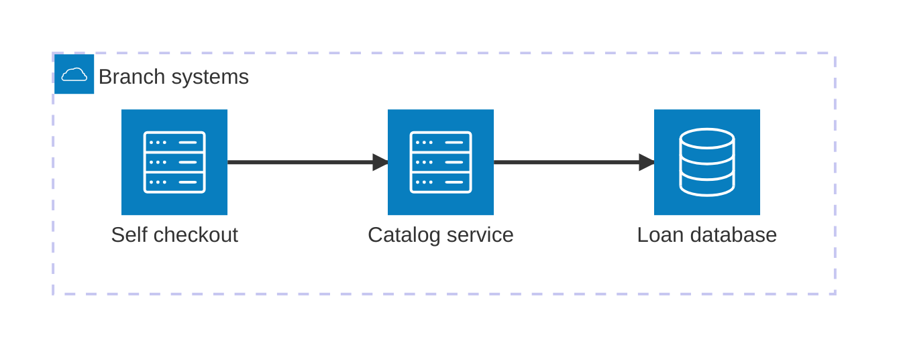

Service and group ids are bare keys — do not quote them. Labels go in `[]`, icons in `()`. Built-in icons are `cloud`, `database`, `disk`, `internet`, and `server`; anything else needs a registered icon pack the bundled renderer may not have.

- Quote labels that hold non-ASCII, dots or hyphens: `service kiosk(server)["Self-checkout"]`. Pele accepts them bare, but pre-1.15 bundles rejected them.
- Declaration order sets the layout. If an edge runs through another service, reorder the declarations. A bent edge may overlap a group border.

**Fallback:** the flowchart under [Fallbacks](#fallbacks-that-keep-the-meaning), which keeps the topology and loses only the icons.

### XY chart

Numeric series over categories, as bars, lines, or both.

**Use** for size by category or a trend over time. **Avoid** for a profile across three or more criteria (radar). **Keep under** 12 categories and 3 series.

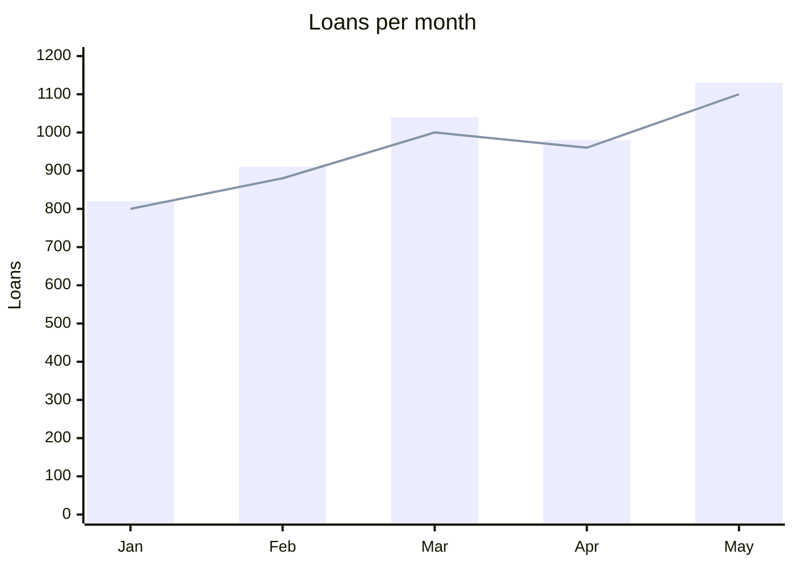

Current Mermaid accepts `xychart` and `xychart-beta`; older bundles accept only `xychart-beta`. Keep every series the same length as the x-axis category list. Start the y-axis at 0 and end it a little above the largest value.

With more than seven categories or long category names, use horizontal bars: in vertical bars Pele silently drops every other category label that does not fit. `xychart horizontal` is Pele-only.

```mermaid
xychart horizontal
  title "Loans by section"
  x-axis ["Fiction", "Children", "History", "Science", "Travel", "Cooking", "Poetry", "Music", "Law"]
  y-axis "Loans" 0 --> 400
  bar [350, 290, 120, 110, 80, 75, 40, 30, 10]
```

The chart keeps its height when narrowed, so give it its own height budget in a narrow column.

**Fallback:** a Markdown table of the same numbers. It keeps every value and loses only the shape — say so when you ship it.

## Pele-only

These families need Obsidian 1.15.0+ on every device that reads the note. Each fallback is a conservative-core diagram or a table that keeps the meaning.

### Swimlane

**Use** when several actors share one process and the hand-offs are the point. **Avoid** with a single actor (flowchart). **Keep under** 4 lanes and 12 nodes. **Fallback:** a flowchart with one subgraph per actor.

```mermaid
swimlane-beta LR
  subgraph reader["Reader"]
    ask["Request title"]
    pick["Pick up"]
  end
  subgraph desk["Desk staff"]
    check["Check catalog"]
    order["Order from network"]
  end
  subgraph courier["Courier"]
    ship["Deliver to branch"]
  end
  ask --> check
  check -->|"on shelf"| pick
  check -->|"missing"| order --> ship --> pick
```

One subgraph is one lane; name lanes after people or roles. The diagram stays near 580 pixels wide however narrow the note is.

### Block

**Use** for a page, screen or system divided into a grid where relative cell size is the meaning. **Avoid** when flow is the point (flowchart). **Keep under** 4 columns and 12 blocks. **Fallback:** a nested list or table of the regions.

```mermaid
block-beta
  columns 3
  head["Entrance and returns"]:3
  block:STACKS:2
    columns 2
    fic["Fiction"]
    non["Non-fiction"]
    kids["Children"]:2
  end
  desk["Help desk"]
  study["Study rooms"]:3
```

`columns N` sets the grid and `id:span` the width; `block:ID:span … end` nests a region with its own `columns`.

### Agentflow

**Use** for agents that split work and call tools. **Avoid** when no tool is called (swimlane). **Keep under** 4 flows and 10 nodes. **Fallback:** a flowchart with one subgraph per agent and tool calls as edge labels.

```mermaid
agentflow-beta TB
  connector llm["Language model"]
  llm@{ protocol: "http", endpoint: "/v1/chat" }

  flow intake["Intake agent"]
    q["Reader question"]@{ shape: input }
    plan["Split into lookups"]@{ shape: task }
    q --> plan
  end

  flow lookup["Catalog agent"]
    search["Search catalog"]@{ shape: tool, connectorRef: "llm.run", returns: "Records" }
    rules["Lending policy"]@{ shape: refdoc }
    search -.- rules
  end

  flow review["Reviewer"]
    judge["Check answer"]@{ shape: action }
  end

  plan --> search
  search --> judge
```

Node shapes are `input`, `task`, `tool`, `action` and `refdoc`. A connector is drawn apart from the nodes, not joined by an edge.

### Git graph

**Use** for versions, branches and merges, including drafts and revisions of a document. **Avoid** without branches (timeline). **Keep under** 3 branches and 12 commits. **Fallback:** a timeline per branch.

```mermaid
---
config:
  gitGraph:
    rotateCommitLabel: false
---
gitGraph
  commit id: "Policy v1"
  branch revision
  checkout revision
  commit id: "Draft fines"
  commit id: "Board notes"
  checkout main
  commit id: "Typo fix"
  merge revision id: "Adopted" tag: "v2"
```

- The keyword is case-exact: `gitgraph` fails with *No diagram type detected* (*observed*).
- With a merge, set `rotateCommitLabel: false`; Pele's 45-degree commit labels cover the merge curve. `gitGraph TB:` draws it vertically for many commits or a narrow column.

### Event modeling

**Use** for a design where screens, commands, events and processors change state over time. **Avoid** outside design documents (sequence reads more easily). **Keep under** 8 timeframes. **Fallback:** a sequence diagram plus a table of fields.

```mermaid
eventmodeling

timeframe 01 ui HoldForm
timeframe 02 command PlaceHold [[PlaceHold01]]
timeframe 03 event HoldPlaced [[HoldPlaced]]
timeframe 04 processor NotifyReader

data PlaceHold01 {
  titleId: 'T-100'
  branch: 'Central'
}

data HoldPlaced {
  holdId: string
  queuePosition: number
}
```

`data` blocks carry the fields of a command or event.

### Radar

**Use** for the profiles of a few subjects across several criteria. **Avoid** with two criteria (quadrant) or one (xy chart). **Keep under** 3–8 axes and 4 curves; two curves read best. **Fallback:** a table, one row per subject.

```mermaid
radar-beta
  title Branch profiles
  axis vis["Visits"], loa["Loans"], eve["Events"]
  axis dig["Digital"], hrs["Hours"]
  curve central["Central"]{4, 5, 3, 4, 5}
  curve east["East"]{3, 2, 5, 2, 3}
  graticule polygon
  max 5
  min 0
```

State `max` and `min` explicitly.

### Quadrant chart

**Use** for placing items on two criteria and naming the quadrants. **Avoid** when positions are an impression without evidence, or say in the caption that they are a judgement. **Keep under** 12 points. **Fallback:** a 2×2 table.

```mermaid
quadrantChart
  title Programs by reach and cost
  x-axis "Low cost" --> "High cost"
  y-axis "Few readers" --> "Many readers"
  quadrant-1 "Fund carefully"
  quadrant-2 "Expand"
  quadrant-3 "Reconsider"
  quadrant-4 "Cut"
  "Story time": [0.2, 0.8]
  "Maker space": [0.8, 0.6]
  "Film club": [0.3, 0.2]
  "Book bus": [0.85, 0.25]
```

Quote axis labels, quadrant labels and point names, and keep parentheses and colons out of them: Pele accepts both, but pre-1.15 Mermaid rejected them. Do not quote `title`; Pele draws the quotes. The minimum width is about 280 pixels, so a square column suits it best.

### Venn

**Use** for the overlap of two or three sets and what sits in each intersection. **Avoid** with four or more sets (table or quadrant). **Keep under** 3 sets. **Fallback:** a table of items by membership.

```mermaid
venn-beta
  title Who uses which service
  set R["Readers"]
    text R1["Print loans"]
  set S["Students"]
  set O["Online users"]
  union R,S["Study rooms"]
  union R,O["E-books"]
  union R,S,O["Catalog search"]
```

`union` names an intersection, `text` an item in one set only. Keep intersection labels short; a label longer than its region spills past the circles.

### Requirement diagram

**Use** for tracing requirements to what satisfies or verifies them. **Avoid** for presentations (a table reads better). **Keep under** 5 requirements. **Fallback:** a table with one row per requirement and its satisfying and verifying elements.

```mermaid
requirementDiagram
  direction LR
  requirement holds {
    id: R1
    text: "A reader can hold any circulating title"
    risk: medium
    verifymethod: test
  }
  performanceRequirement notice {
    id: R2
    text: "Pickup notice is sent within one hour"
    risk: low
    verifymethod: analysis
  }
  element holdService {
    type: service
    docref: "Hold service spec"
  }
  holds - contains -> notice
  holdService - satisfies -> holds
```

- Quote `text` and `docref`; unquoted non-ASCII text fails with *Lexical error* (*observed*).
- `test` is a reserved word: valid as a `verifymethod`, a parse error as an element `type` (*observed*).
- The diagram stays near 790 pixels wide however narrow the note is.

### C4 context

**Use** for people, internal systems and external systems on one page. **Avoid** when component layout is the point (architecture). **Keep under** 8 elements. **Fallback:** a flowchart with a subgraph for the system boundary.

```mermaid
C4Context
  title Library systems context
  Person(reader, "Reader", "Borrows and reserves titles")
  System_Boundary(lib, "Library") {
    System(catalog, "Catalog", "Search and holds")
    System(circ, "Circulation", "Loans and returns")
  }
  System_Ext(network, "Regional network", "Interlibrary loans")
  Rel(reader, catalog, "Searches")
  Rel(catalog, circ, "Creates loans")
  Rel(circ, network, "Requests missing titles")
  UpdateRelStyle(catalog, circ, $offsetX="-40", $offsetY="-20")
```

When relation labels collide, move one with `UpdateRelStyle(from, to, $offsetX, $offsetY)`.

### Use case

**Use** for what actors want from a system and its scope. **Avoid** for a feature list (table). **Keep under** 3 actors and 8 use cases. **Fallback:** a flowchart with a subgraph for the system boundary.

```mermaid
usecase-beta
direction LR
actor Reader("Reader")
actor Staff("Staff")
systemBoundary Catalog
  Search("Search titles")
  Hold("Place hold")
  Notify("Send notice")
end
Reader --> Search
Reader --> Hold
Staff --> Notify
Hold ..> : include Notify
```

Keep actor and use-case ids ASCII and put the display name in quoted parentheses, `actor Reader("독자")`; a non-ASCII id fails to parse (*observed*).

### Packet

**Use** for the position and width of fixed-length fields in an identifier or code. **Avoid** when field lengths vary (railroad). **Keep under** 12 fields. **Fallback:** a table of positions and meanings.

```mermaid
---
title: "Barcode layout (character positions)"
config:
  packet:
    bitsPerRow: 16
---
packet-beta
0-1: "Branch"
2: "-"
3-8: "Item number"
9: "-"
10-15: "Check digits"
```

When the cells are characters rather than bits, say so in the title.

### Railroad

**Use** for a notation or naming rule written as EBNF. **Avoid** for a one-line rule (show an example in prose). **Keep under** 6 rules. **Fallback:** the EBNF in a code block.

```mermaid
railroad-ebnf-beta
title "Shelf mark"

shelfmark = section "." number [ "/" volume ] ;
section = "FIC" | "HIS" | "SCI" ;
number = digit { digit } ;
volume = digit { digit } ;
digit = "0" | "1" | "2" | "3" | "4" | "5" | "6" | "7" | "8" | "9" ;
```

Write optional parts as `[ … ]`. Two `?` in one rule are read as an EBNF special sequence `? … ?`, not as two optional marks.

### Tree view

**Use** for folders, files and other path-shaped hierarchies. **Avoid** when the hierarchy carries sizes (treemap). **Keep under** 20 lines. **Fallback:** a nested list in a code block.

```mermaid
treeView-beta
  library/
    catalog/
      books.csv ## one row per book
    circulation/
      loans.csv
    policy.md ## lending rules
```

End folders with `/`; `##` starts a right-hand comment. An entry whose name starts with `title` is read as the diagram title and fails to parse (*observed*).

### Ishikawa

**Use** for collecting the causes of one problem by category. **Avoid** when causes depend on each other (flowchart). **Keep under** 4–6 categories and 15 causes. **Fallback:** a nested list under the problem.

```mermaid
ishikawa-beta
  Holds expire unclaimed
  Notice
    Email lands in spam
    No SMS option
  Schedule
    Pickup window too short
  Location
    Hold shelf hard to find
```

The first line is the problem, one indent a category, two indents a cause.

### Cynefin

**Use** for sorting work into clear, complicated, complex and chaotic domains and showing movement between them. **Avoid** without evidence for the placement. **Keep under** 3 items per domain. **Fallback:** a four-row table.

```mermaid
cynefin-beta
  title Where branch work sits
  clear
    "Shelving returns"
  complicated
    "Budget allocation"
  complex
    "Community programs"
  chaotic
    "Flooded basement"
  chaotic --> complex : "Stabilize"
  complex --> complicated : "Turn patterns into rules"
```

Items are quoted strings. Transition labels overlap the dashed domain borders, and the diagram stays near 780 pixels wide.

### Wardley map

**Use** for placing value-chain components by visibility and evolution. **Avoid** presenting impressionistic coordinates as data; say in the caption that placement is a judgement. **Keep under** 10 components. **Fallback:** a flowchart of the dependencies plus a table of evolution stages.

```mermaid
wardley-beta
title Reader service value chain

anchor "Reader" [0.95, 0.70]
component "Holds" [0.80, 0.55]
component "Catalog" [0.60, 0.70]
component "Search index" [0.40, 0.45]
component "Hosting" [0.20, 0.90]

"Reader" -> "Holds"
"Holds" -> "Catalog"
"Catalog" -> "Search index"
"Search index" -> "Hosting"

evolve "Search index" 0.70

note "Placement is a judgement" [0.15, 0.30]
```

Coordinates are `[visibility, evolution]`. Quote names; an unquoted name with a dot fails with *Lexical error* (*observed*). Notes draw at the same weight as the title.

## Fallbacks that keep the meaning

A fallback replaces the drawing, never the information. Worked example — the architecture diagram above, expressed with the conservative core:

```mermaid
flowchart LR
  subgraph Branch systems
    kiosk[Self checkout]
    catalog[Catalog service]
    store[(Loan database)]
  end
  kiosk --> catalog
  catalog --> store
```

Every service, the group boundary, and both links survive; only the icon set is gone, which is the kind of loss worth one sentence of disclosure.

| Gated family | Fallback | What the fallback drops |
| --- | --- | --- |
| `sankey` | `flowchart LR` with quantities in edge labels | Width-proportional flow |
| `kanban` | Table with one column per stage | Card metadata styling |
| `treemap-beta` | `pie` plus a nested list | Area proportionality across levels |
| `architecture-beta` | `flowchart LR` with a subgraph per group | Icons and port-level edge anchoring |
| `xychart-beta` | Table of values | The visual shape of the series |

Each Pele-only pattern names its own fallback. When the dropped column above matters to the reader, keep it in prose or a table beside the fallback rather than deleting it.
