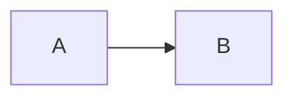
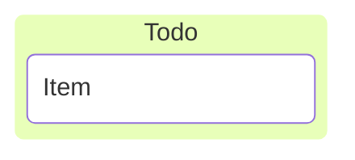
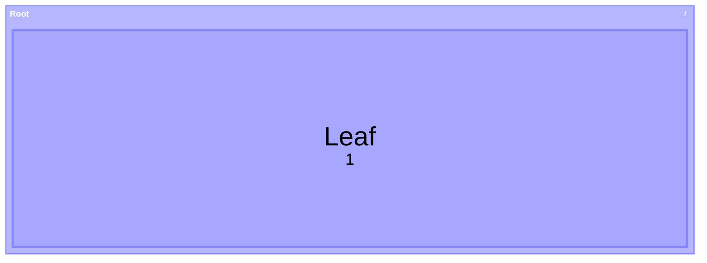
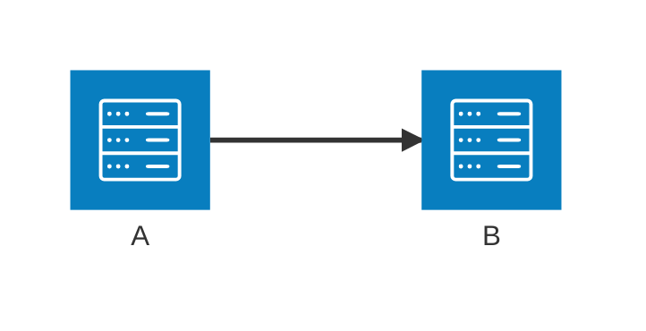
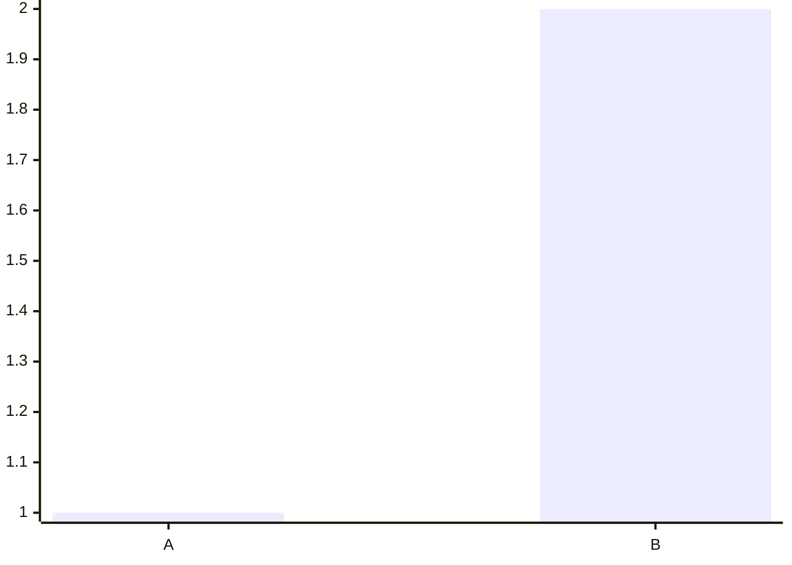
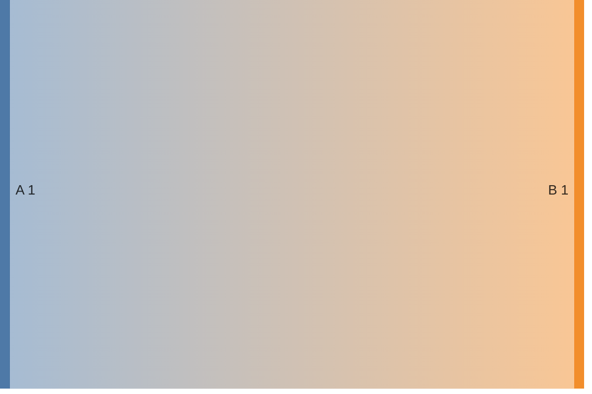

# Pele compatibility gate

Decide whether a diagram family will render in the Obsidian installation that actually holds the note, before writing it there.

## Why this is a separate question

Since Obsidian 1.15.0 the app no longer includes Mermaid. A `mermaid` fence is drawn by Pele, Obsidian's own MIT-licensed renderer, which targets Mermaid 12.1.0 syntax and supports every diagram type built into Mermaid 12.1.0. `loadMermaid()` and `window.mermaid` are kept as a compatibility surface that draws with Pele; `window.pele` is available once `loadMermaid()` resolves. Earlier apps ship a Mermaid build pinned inside the app. Neither renderer is a plugin, separately installable, or user-selectable: each moves only when the app moves.

Consequences:

- **The app version is the gate.** 1.15.0 or later means Pele; earlier means an older pinned Mermaid bundle with the version gates below. A vault synced to several devices is only as new as its oldest app.
- **A pass elsewhere is not evidence here.** mermaid.live, code hosts and other note apps run real Mermaid, not Pele, on their own schedule.
- **Identical source looks different.** Pele uses its own layout, so node positions, spacing and edge paths differ from Mermaid. Mermaid themes and `themeVariables` colors do not apply; colors and fonts come from the vault theme through `--mermaid-*` CSS variables. Judge appearance only in the target.
- **No code runs.** Pele ignores JavaScript callbacks in `click`, blocks `javascript:`, `data:` and `vbscript:` links, escapes text and filters styles. That is why 1.15.0 removed the *Show Mermaid diagrams in notes* setting and draws diagrams without asking.
- **Not supported by Pele:** ZenUML and other external Mermaid plugins, and arbitrary HTML labels. Source over 50,000 characters, SVG output over 4,000,000 characters, or a flowchart over 5,000 edges is rejected.

## The gate

1. Is the target app 1.15.0 or later on every device that reads the note? Any family Pele lists in its compatibility table is acceptable; still prefer the conservative core when it carries the meaning.
2. Otherwise, is the family in the catalog's conservative core? Use it.
3. Version-gated, and you have observed evidence from *this* installation? Use it, and record the evidence.
4. Version-gated with no observed evidence? Either run the probe below, or ship the documented fallback and disclose that the preferred family was untested. An unknown app version is an old one.

Never resolve step 4 by assuming, by quoting a version number from another machine, or by citing a render that happened somewhere else.

## Keyword notes

| Family | Write this | Why |
| --- | --- | --- |
| `flowchart` | `flowchart` | `graph` is an accepted alias; `flowchart` is the current documented keyword |
| `stateDiagram-v2` | `stateDiagram-v2` | Pele accepts both; on older bundles the unsuffixed form selects the legacy renderer |
| `architecture-beta` | `architecture-beta` | The only spelling Pele lists; Mermaid documents it as v11.1.0+ |
| `treemap` | `treemap-beta` | Pele accepts both; older bundles need the suffix |
| `sankey` | `sankey-beta` | Pele accepts both; older bundles accept only the suffixed form |
| `xychart` | `xychart-beta` | Same optional-suffix pattern |
| `kanban` | `kanban` | No documented version badge; probe on pre-1.15 apps |

The optional-suffix pattern is the useful general rule: when both spellings are accepted, the `-beta` one also works on older bundles.

Families Pele added beyond the old catalog — `quadrantChart`, `requirementDiagram`, `gitGraph`, `C4*`, `block`, `packet`, `radar-beta`, `venn-beta`, `ishikawa`, `wardley-beta`, `railroad-*`, `treeView-beta`, `cynefin-beta`, `eventmodeling`, `usecase-beta`, `agentflow-beta`, `swimlane-beta` — need 1.15.0+ everywhere the note is read. Start from their patterns in the catalog's Pele-only section, not from memory. Pele also accepts `C4Container`, `C4Component`, `C4Dynamic`, `C4Deployment`, `railroad-beta`, `railroad-abnf-beta`, `railroad-peg-beta`, and the unsuffixed `block`, `packet` and `ishikawa`.

## The Pele inside the app lags Pele releases

Obsidian bundles one Pele build and moves it only when the app updates, so a feature in Pele's release notes is not evidence for the vault. In Obsidian 1.15.0 (installer 1.13.4), `pele.render()` rejected a Hangul sankey node name and drew `<kbd>` and `<code>` label tags as plain text, both of which Pele 1.9.0 supports. Probe a feature from a recent release before relying on it, and keep the older form when the probe fails.

Host options are the app's choice, not the note's. Obsidian 1.15.0 typesets `$$...$$` labels with MathJax in a rendered note (observed through Obsidian's Markdown renderer), while a bare `pele.render()` call without a `math` resolver shows the TeX source. The narrow-width switch from `LR` to `TB`, sankey gradients and the size limits are host options too; a note cannot set them.

A `---` delimited config header or a `%%{init}%%` directive is accepted by Pele, but configuration support varies by diagram type, and on older bundles it is version-gated on its own. If a block fails, remove the config and retest before concluding the family is unsupported.

## Capability probe

There are two probes. Neither writes a note in the read-only form.

**Parse/render probe (level B, read-only).** In a running 1.15.0+ app, through the `eval` command that `obsidian-cli` owns, call `pele.render(source)` once per candidate. It returns `{svg}` or throws a `PeleError` such as *No diagram type detected for the given text.* or *Parse error on line N*. This proves Pele's grammar acceptance in that app, not that the note renders. Run the `obsidian` CLI directly; do not wrap it in a script.

**Render probe (level D).** Writing a probe note is a vault mutation: it needs the task's own authorization, an agreed location, and an agreed cleanup. A scratch vault avoids the question and answers it just as well, because the renderer belongs to the app, not to the vault. Put one fence per candidate family into a single note, each with the smallest body that family accepts:

````markdown











````

Open the note in the target installation and read the result per block. A drawn diagram is a pass. An error message, a raw dump of the source, or a blank area where the block should be is a failure — all three mean the same thing for the gate.

Check both Reading view and Live Preview: the same block can render in one and not the other, and both are reachable by whoever reads the note.

## Reading a failure

| Symptom | Most likely cause | Next step |
| --- | --- | --- |
| The minimal probe block for a family fails | The app predates Pele and its bundle has no such diagram | Use the fallback; stop trying to rewrite the grammar |
| The minimal block renders but yours does not | A newer feature inside a supported family, or a Pele parse difference | Remove the newest-looking parts (config header, metadata, styling, per-point labels) one at a time until it renders |
| It renders but is unreadable | Readability, not compatibility | Split the diagram or shorten labels; do not change family. Pele scales a wide diagram down and offers zoom and pan, which is not legibility |
| It renders on desktop but not after sync to another device | A different app version on that device | Probe there too; record both |

Bisecting is the point of step two: a diagram that fails as a whole and renders after one line is removed has told you exactly which feature the renderer lacks.

## Render QA, and what it is not

Parse validation and render QA answer different questions. Parsing says a grammar was accepted by some build. Render QA says this installation drew this diagram in this note.

Render QA is done when all of these have been looked at:

- The block draws a diagram in Reading view and in Live Preview.
- Labels are legible at the note's actual width, without relying on zoom.
- The diagram is readable in the theme the vault actually uses, including dark mode if that is the default.
- No label is clipped, overlapped, or pushed outside the diagram box.
- If the note is exported or read on another device, the diagram was checked there too.

If any of these could not be checked, say which, rather than implying a full pass.

## Recording the result

Record what was observed, not what was assumed:

```text
Obsidian app version: <as reported by the app>
Installer version:    <as reported by the app>
Platform:             <desktop OS or mobile>
Renderer:             Pele (1.15.0+) | bundled Mermaid, version unknown
Renders:              <families that drew>
Fails:                <families that did not>
Checked in:           Reading view / Live Preview / theme / export
```

Do not invent a renderer version. The app reports app and installer versions; the Pele build inside it exposes no version field, and a pre-1.15 Mermaid version is not part of that surface either. A guessed number is worse than an honest `unknown`.

## Sources

- Obsidian 1.15.0 desktop changelog (early access, 2026-10-22), for the switch to Pele, the removed setting, `--mermaid-*` variables and the `loadMermaid()`/`window.pele` surface — <https://obsidian.md/changelog/2026-10-22-desktop-v1.15.0/>
- Pele repository, MIT — <https://github.com/obsidianmd/pele>
- Pele compatibility table and differences from Mermaid — <https://pele.run/compatibility>
- Pele release notes, for features added after the build an app bundles — <https://github.com/obsidianmd/pele/releases>
- CMDSPACE Pele gallery, for use, avoid and size guidance per family observed in Pele 1.9.0 — <https://pele.cmdspace.work/>
- Pele security and size limits — <https://pele.run/security>
- Mermaid documentation, for grammar — <https://mermaid.js.org/intro/>
- Mermaid flowchart syntax, including quoting and entity-code escapes — <https://mermaid.js.org/syntax/flowchart.html>
- Obsidian advanced formatting help, for the `mermaid` fence and `internal-link` class — <https://help.obsidian.md/advanced-syntax>

When one of these changes the grammar or a version gate, re-probe the affected family, and fix the catalog entry.
