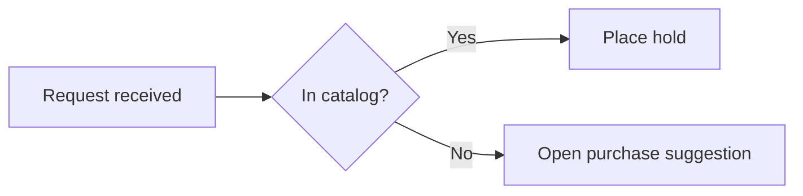

# Pele diagrams

Produce a `mermaid` fence that carries the intended meaning and renders in the renderer the target Obsidian installation actually ships: Pele from 1.15.0, an older pinned Mermaid bundle before that.

Done means: the diagram family fits the relationship being shown, the prefix and grammar are accepted by the target renderer, the source sits in an exact `mermaid` fence, unrelated note content is byte-for-byte untouched, and every claim is backed by the evidence level that actually produced it.

## What changed

Obsidian 1.15.0 stopped bundling Mermaid. The fence is still written ```` ```mermaid ```` and the grammar is still Mermaid's, but Pele draws it: Mermaid 12.1.0 syntax, every built-in Mermaid 12.1.0 diagram type, Pele's own layout, and colors and fonts from the vault theme. Pele runs no code, so diagrams render without a confirmation setting. [`pele-compatibility.md`](pele-compatibility.md) holds the differences, limits and the gate for older apps.

Pele has no command-line tool. Its only runtime surface inside Obsidian is `window.pele` (`render`, `parse`, `detectType`, `supports`) and the `loadMermaid()`/`window.mermaid` compatibility shim, reached through the official CLI's `eval`. Name those calls; do not write a script around them.

## Evidence ladder

Four separate claims. Never report a higher level on the strength of a lower one.

| Level | What it proves | How it is produced |
| --- | --- | --- |
| A — Authoring check | The prefix, grammar, labels, and fence follow the documented rules | Reading the source against [`pele-catalog.md`](pele-catalog.md) and the rules below |
| B — Parse validation | A named renderer accepts the grammar | `pele.render(source)` through `obsidian eval` in a 1.15.0+ app, with the app version stated. mermaid.live or Mermaid CLI only prove real Mermaid, not Pele |
| C — Materialized readback | The intended bytes are in the intended note and nothing else moved | Re-reading the file after the write and diffing against what you intended |
| D — Render QA | This vault's renderer draws it in the note | Opening the note in the target Obsidian and looking at the result |

B is not D. `pele.render()` in one app proves grammar acceptance there, not the note's layout, theme, or an older device's bundle. C is not D either: writing a fence is not rendering it.

When a level cannot be reached — no app access, no vault authorization, headless environment — say which level was reached and name the rest as unverified.

## Workflow

1. **State the meaning first.** Write the sentence the diagram must communicate (sequence of steps, message order, state transitions, proportions, hierarchy, flow quantities). The sentence chooses the family.
2. **Pick the smallest family that carries it** using the table below.
3. **Apply the compatibility gate** in [`pele-compatibility.md`](pele-compatibility.md). An unknown app version is an old one.
4. **Start from the catalog entry**, not from memory. Replace labels and data; leave the grammar alone.
5. **Write labels** under the escaping and readability rules below.
6. **Fence it exactly** (see Fences and placement).
7. **Only if the task actually edits a note:** confirm write authorization for that exact note, make the narrowest possible edit, and read the file back (see Editing a note safely).
8. **Render QA** in the target installation, recording the Obsidian app and installer versions it reports.
9. **On a renderer failure, fall back without losing meaning** (see Failing without degrading meaning).

## Choosing the family

| The meaning to carry | Family | Notes |
| --- | --- | --- |
| Ordered steps with branches | `flowchart TD` / `flowchart LR` | The default; also the fallback for any structural diagram |
| Who sends what to whom, in order | `sequenceDiagram` | Name participants explicitly; arrow type encodes sync/async/return |
| Types, fields, and cardinality | `classDiagram` | Use for a domain model, not for runtime steps |
| Lifecycle of one thing | `stateDiagram-v2` | Exact `-v2` suffix |
| Stored entities and their keys | `erDiagram` | Schema shape, not process |
| Dated work with durations | `gantt` | Needs `dateFormat`; durations, not vibes |
| Step-by-step experience with scores | `journey` | Score and actor follow each task label |
| Parts of one whole | `pie` | Quote every label; one level only |
| Branching outline of one topic | `mindmap` | Indentation is the grammar — keep it consistent |
| Dated milestones in order | `timeline` | One period line, then its events |
| Quantified flow between stages | `sankey-beta` | CSV-shaped rows: source, target, value |
| Work items across workflow columns | `kanban` | Version-gated before 1.15.0 |
| Nested proportions | `treemap-beta` | Version-gated before 1.15.0 |
| Services, groups, and their links | `architecture-beta` | Version-gated before 1.15.0 |
| Numeric series over categories | `xychart-beta` | Version-gated before 1.15.0 |
| Several actors handing off one process | `swimlane-beta` | Pele-only |
| A page or screen divided into a grid | `block-beta` | Pele-only |
| Agents splitting work and calling tools | `agentflow-beta` | Pele-only |
| Versions, branches and merges | `gitGraph` | Pele-only; case-exact keyword |
| Screens, commands and events changing state | `eventmodeling` | Pele-only |
| A few subjects profiled on several criteria | `radar-beta` | Pele-only |
| Items placed on two criteria | `quadrantChart` | Pele-only |
| Overlap of two or three sets | `venn-beta` | Pele-only |
| Requirements traced to what satisfies them | `requirementDiagram` | Pele-only |
| People, systems and external systems | `C4Context` | Pele-only |
| What actors want from a system | `usecase-beta` | Pele-only |
| Fixed-width fields of an identifier | `packet-beta` | Pele-only |
| A notation rule as EBNF | `railroad-ebnf-beta` | Pele-only |
| Folder and file paths | `treeView-beta` | Pele-only |
| Causes of one problem by category | `ishikawa-beta` | Pele-only |
| Work sorted into Cynefin domains | `cynefin-beta` | Pele-only |
| Value chain by visibility and evolution | `wardley-beta` | Pele-only |

Each catalog pattern also names when to avoid its family and the size past which it stops being readable. Use a Pele-only family only when every device that reads the note runs 1.15.0+.

Split a diagram at a real boundary (phase, actor, subsystem) as soon as labels overlap or edges cross unreadably. Pele scales wide diagrams down and lets the reader zoom and pan; that is not readability. Two readable diagrams beat one complete unreadable one.

## Syntax that actually breaks

Each rule below was rechecked with `pele.render()` in Obsidian 1.15.0.

- **Prefix is literal.** `stateDiagram-v2`, `sequenceDiagram`, `classDiagram`, `architecture-beta` — exact case, exact suffix. An unknown prefix fails with *No diagram type detected*, not a fallback.
- **`flowchart` vs `graph`.** Both are accepted; `flowchart` is the current documented keyword and the one to write.
- **Lowercase `end` breaks a flowchart.** Write `End` or `END`, or put the word inside a quoted label.
- **A node id starting with `o` or `x` right after an edge changes the edge.** `A---oB` is a circle edge and `A---xB` a cross edge; add a space or capitalize (`A--- Ops`).
- **Quote troublesome labels.** Parentheses, colons, slashes, `#`, and non-ASCII belong inside `"..."`: `id1["Renewal (second request)"]`. Quote the label, not the identifier, and do not add quotes to grammars that take bare keys, such as `architecture-beta` service ids.
- **Escape with entity codes when quoting is not enough.** `#quot;` for a double quote, `#35;` for `#`, decimal codes like `#9829;`.
- **Line breaks.** Use `<br/>`, or a Markdown string label — a double-quoted label whose text is wrapped in backticks — which also takes `**bold**`. Pele also breaks on a literal `\n` inside a quoted label, but older bundles print the two characters, so do not write it.
- **No HTML labels.** Pele draws labels as SVG text; arbitrary HTML is not rendered. `<code>`, `<kbd>`, `<sub>` and `<sup>` draw as plain text in Obsidian 1.15.0; write a literal angle bracket as `#lt;` and `#gt;`.
- **Math labels.** A `$$...$$` label is typeset by the host. Obsidian 1.15.0 typesets it with MathJax in a rendered note; a bare `pele.render()` call shows the TeX source. Math works in flowchart, swimlane, sequence, state, class, ER, mindmap, kanban, block, requirement and use case.
- **Subgraph `direction` holds in Pele** even when an edge crosses the boundary; older bundles ignore it then. Do not rely on it for layout that must survive both.
- **Comments are `%%` at line start.** They are not Markdown comments and not HTML comments.
- **No themes.** `theme` and `themeVariables` colors do not apply; the vault theme decides colors.

## Fences and placement

The block must open with exactly three backticks followed by `mermaid`, with nothing else on the line, and close on its own line. There is no `pele` fence:

````markdown

````

- One diagram per fence. A second prefix inside the same fence is a parse error.
- To show a block as example text rather than render it, wrap it in a four-backtick fence, as above.
- Inside a callout or blockquote, every line of the block — including both fence lines — needs the `>` prefix.
- Inside a list item, indent the whole block to the item's content column.
- Obsidian links from diagram nodes use the `internal-link` class (`class NodeA,NodeB internal-link;`); quote note names containing special characters. Pele keeps the class on the node; whether the link navigates in 1.15.0 is unverified until checked at level D. Those links do not appear in Graph view.
- `click` statements that open an `http`, `https`, `mailto` or `tel` link work; JavaScript callbacks are ignored.

## Editing a note safely

Authoring a diagram grants no write permission. A write needs the task's own authorization for that exact note, and the vault's live policy still decides placement and house style.

- Read the note first; locate the exact insertion point or the exact existing fence to replace.
- Anchor the edit on unique surrounding text, replacing only the diagram block. Never reformat, re-wrap, reorder, or "clean up" anything else, including frontmatter, tags, and whitespace.
- Never write vault notes with shell redirection or stream editors. Use the host file-editing tool or the vault-aware surface the task selected.
- Read the file back after the write and confirm both that the fence is exactly as intended and that unrelated content is unchanged. A successful write call is not readback.
- Compose the `obsidian-markdown` package by identity only when the task genuinely also changes note prose, links, embeds, or properties.

## Failing without degrading meaning

When the target renderer rejects the chosen family, the replacement must still carry the sentence from step 1.

1. Re-state what the original diagram encoded: entities, relations, order, quantities, hierarchy.
2. Choose a fallback that keeps all of it — usually `flowchart` for structure, `pie` for a single-level proportion, or a Markdown table for values.
3. If the fallback cannot carry part of it (a `pie` drops hierarchy; a `flowchart` drops magnitudes), ship the fallback **and** the dropped information in a table or list beside it.
4. Say so in the note or the report: which family was intended, what the target rejected, what the fallback preserves, and what it does not.

Silently shipping a smaller diagram that says less is a wrong answer that looks like a right one. So is leaving a broken fence in place because the fallback would be uglier.

## Boundaries

- Mermaid rendered anywhere other than the target Obsidian install — a static site, a code host, a live editor — runs real Mermaid and does not inherit this baseline.
- The Excalidraw plugin's own Mermaid import (`addMermaid`) converts source into drawing elements; it belongs to the Excalidraw branch in [`plugin-workflow.md`](plugin-workflow.md), and whether it uses Pele is unverified.
- Vault policy owns whether the note may be written at all.

## Verification

- [ ] The sentence the diagram must carry is stated, and the family carries it.
- [ ] The prefix is exact, and any version-gated family passed the compatibility gate.
- [ ] Labels are quoted or escaped where the grammar needs it, and contain no literal `\n`.
- [ ] The block is in an exact `mermaid` fence, one diagram per fence, correctly nested if inside a callout or list.
- [ ] If a note was edited: authorization existed, the edit was anchored, and readback confirmed unrelated content is unchanged.
- [ ] The highest evidence level actually reached is reported, with the Obsidian app and installer versions when level B or D was reached.
- [ ] Any fallback preserves the original meaning, or explicitly lists what it drops.
